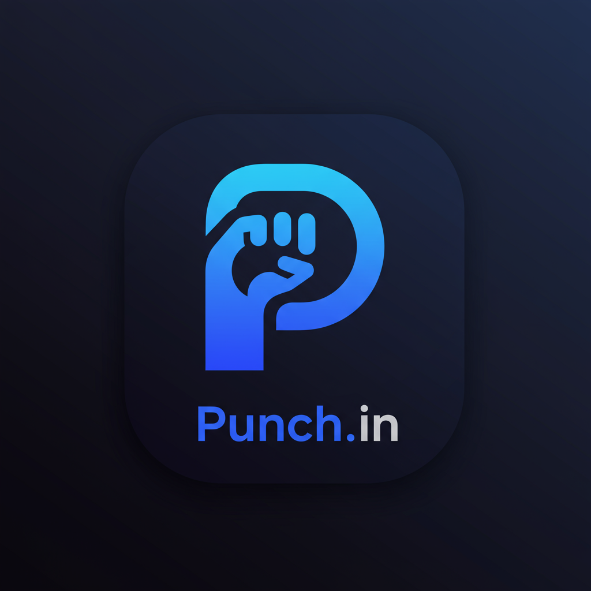

# <p align="center"><br/>Punch.In — Scholar Companion</p>

<p align="center">
  <strong>Next-gen academic attendance intelligence, algorithmic bunk forecasting, and peer study pods.</strong>
</p>

<p align="center">
  
  
  
  
  
</p>

---

## 🌟 Overview

**Punch.In** is an all-in-one companion engineered for college students and engineers to eliminate exam eligibility anxiety. It transforms tedious attendance bookkeeping into a streamlined, automated, and mathematically certain process.

Live product features:
- **Instant Attendance Percentage Editing** — Set or adjust any subject's percentage directly; Punch.In recalibrates your attended and total class counts automatically.
- **The Bunk Engine** — Boundary-condition analysis ($Attended / (Total + B) \ge Req\%$) that projects safe consecutive skips, recovery attendance requirements, and custom condonation models.
- **Collaborative Study Pods** — Connect with classmates via unique Pod IDs. Clone an entire semester's course catalog and weekly timetable in one tap, check group standings, and coordinate zero-penalty bunk days.
- **Free Period Support** — Full support for leisure / no-period slots, excluded automatically from auto-punch requirements and subject metrics.
- **Smart Auto-Punch** — Background period automation synchronized with custom college bell timings.
- **Zero-Knowledge Privacy & Total Purge** — Reset only your timetable or permanently wipe your entire account record in one click from the Danger Zone.
- **Free Standalone Calculator** — SEO-ready, lightweight attendance utility running in browser without login requirement.

---

## ⚙️ Architecture & Tech Stack

- **Client:** React 19, React Router 7, Tailwind CSS v4, Lucide / FontAwesome icons
- **Build & Optimization:** Vite 7 with Rollup manual chunks splitting (`vendor`, `firebase`)
- **Backend & Sync:** Firebase Auth (Google OAuth & Email), Cloud Firestore, LocalStorage fallback
- **Hosting:** Cloudflare Pages (with SPA `_redirects` and custom HTTP security headers)
- **AI Planning:** Groq SDK (Llama 3 inference for personalized academic strategies)

---

## 🚀 Getting Started

### 1. Prerequisites
- Node.js (v18 or higher)
- npm or pnpm
- Firebase project with Firestore and Authentication enabled

### 2. Local Setup
```bash
# Clone the repository
git clone https://github.com/aadithya-vimal/PunchIn.git
cd PunchIn/react-app

# Install dependencies
npm install

# Configure environment variables
cp .env.example .env
# Fill in your Firebase and Google Client ID credentials

# Start Vite dev server
npm run dev
```

### 3. Production Build
```bash
npm run build
```
The output directory is `react-app/dist/`, optimized for immediate deployment on Cloudflare Pages or Vercel.

---

## 📱 Mobile & PWA Optimization

The application UI is fully responsive with:
- Horizontal scrolling matrices for weekly schedules and scenario tables.
- Mobile-adapted stat cards preventing flex overflow.
- Accessible tap targets and dynamic header bar.

---

## 📄 License
This project is licensed under the **GNU Affero General Public License v3.0 (AGPL-3.0)**.
